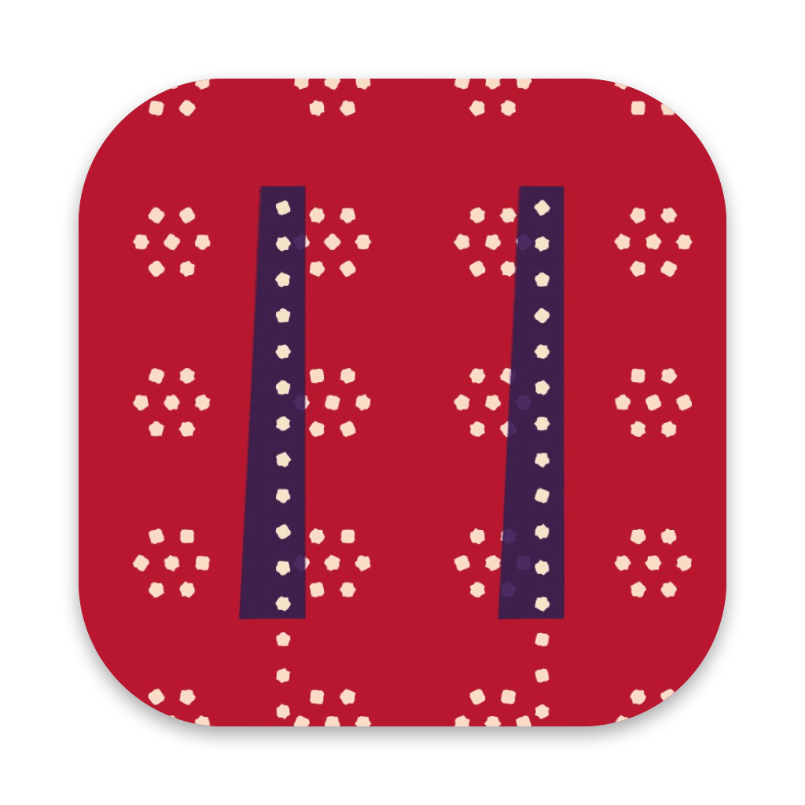

<p align="center">
  
</p>
<h1 align="center">Motifs</h1>
<p align="center">Desktop capture and bug reports for OpenCode, Claude, and Codex.</p>
<p align="center">
  <a href="#downloads">Download</a> ·
  <a href="INSTALL.md">macOS setup</a> ·
  <a href="docs/windows.md">Windows setup</a> ·
  <a href="docs/reference.md">Reference</a> ·
  <a href="https://github.com/milovate/motifs/releases">Releases</a>
</p>

Motifs captures screenshots, recordings, and the context around a bug. Mark up
the image, add a note, and review what you’ll share. Open a draft in OpenCode,
Claude, or Codex, or export the capture for another tool.

## Capture and share

- **Capture a window, region, or display.** Press <kbd>⌥</kbd> <kbd>G</kbd> on
  Mac, choose what to capture, and annotate or crop the screenshot.
- **Record a reproduction.** Press <kbd>⌥</kbd> <kbd>⇧</kbd> <kbd>G</kbd> on Mac
  to record the steps leading up to a bug.
- **Choose the context.** Include window text, browser console errors, failed
  requests, device details, or selected logs. Preview the context before sharing.
- **Choose where it goes.** Open an unsent draft in OpenCode, Claude, or Codex,
  copy a Markdown summary, or save a folder with the capture and context.

## Downloads

The current release is a preview. Its packages are not signed with an Apple
Developer ID or a Windows code-signing certificate, so each platform asks you to
approve the helper once. Check downloads against the release's `SHA256SUMS`.

| Platform | Download | Setup |
| --- | --- | --- |
| macOS (Apple Silicon, macOS 14 or later) | [DMG](https://github.com/milovate/motifs/releases/download/v0.4.3/motifs-0.4.3-macos-arm64.dmg) · [ZIP](https://github.com/milovate/motifs/releases/download/v0.4.3/motifs-0.4.3-macos-arm64.zip) | Open the DMG and follow `Install Motifs.txt`, then [grant capture permissions](docs/macos-permissions.md) |
| Windows x64 (Windows 10 or 11) | [ZIP](https://github.com/milovate/motifs/releases/download/v0.4.3/motifs-0.4.3-windows-x64.zip) | Extract the `motifs` folder and follow [Windows setup](docs/windows.md). Needs the .NET 8 Desktop Runtime. |

Or build from source: [macOS](INSTALL.md) · [Windows](docs/windows.md).

## Get started

**The current build needs a local OpenCode V2 project with the Motifs plugin
loaded.** Each download contains the plugin folder and its native helper, not a
standalone app. The plugin prepares every composer destination, including
Claude, Codex, Clipboard, and Save to folder. Claude and Codex handoff is
available on macOS with the corresponding desktop app installed.

After setup, run `/capture-studio-start` in OpenCode if the helper isn’t running.
Use `/capture-studio` when you want OpenCode to use a saved capture, or
`/capture-studio-annotate` to edit it first. See the
[command and capture reference](docs/reference.md) for the full workflow.
Run `/capture-studio-update` in OpenCode to check for a newer stable release.

## Troubleshooting

| What you see | What to do |
| --- | --- |
| The composer can’t connect to OpenCode | Open or reopen a local OpenCode V2 project with Motifs loaded, then reopen the composer. Your capture stays in Recents. To share a screenshot or recording now, right-click its thumbnail. |
| The capture has no browser errors | Connect the bundled browser extension, reload the tab, reproduce the issue, and check **Context → Console** and **Network**. [Browser setup](docs/reference.md#browser-extension-chrome-brave-edge-arc-chromium) |
| The capture has no native app errors | Motifs reads recent errors from macOS Unified Log or the Windows Application log. If the app writes to a file, choose it under **Custom log files** and capture again. |
| The Mac shortcut doesn’t capture | Start the helper with `/capture-studio-start` and check [Screen Recording permission](docs/macos-permissions.md). |

## Standalone direction

The first milestone is an app you can install, launch, and use with OpenCode
closed. Move bundle preparation and redaction into Motifs so **Copy Markdown**
and **Save bundle** work offline, including the console errors, failed
requests, and logs you select.

OpenCode, Claude, and Codex then become optional destinations. Each integration
only handles its app’s handoff, such as choosing an OpenCode project or opening
a Codex draft. If a destination is unavailable, you can keep editing and share
the capture locally.

## Privacy

Captures and settings are stored locally. Motifs leaves OpenCode drafts unsent.
It redacts text that matches known secret formats before preparing a handoff.
Review screenshots and recordings before sharing because their pixels can still
contain sensitive information.

## Development

```sh
npm ci --ignore-scripts
npm run build
npm test
```

The JavaScript plugin has no runtime npm dependencies. See
[AGENTS.md](AGENTS.md) for contributor instructions.

See [local release checks and signing](docs/releasing.md) for packaging.

## License

Motifs is licensed under the [Apache License 2.0](LICENSE).
